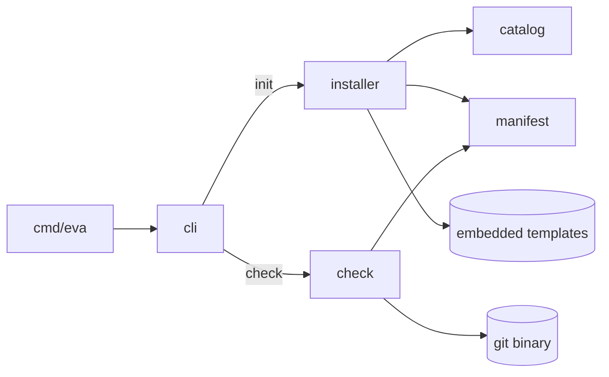

# Contributing and architecture

**English** · [Español](es/contributing.md) · [Docs index](README.md)

## Setup

Requirements: Go 1.24+ and git.

```sh
git clone https://github.com/codebymaribel/eva-sdd && cd eva-sdd
make test     # go test ./...
make lint     # go vet + gofmt check
make build    # bin/eva (version from git describe)
make install  # go install ./cmd/eva
make golden   # regenerate installer golden files after editing templates/
```

CI (`.github/workflows/ci.yml`) runs `make lint` and `make test` on pushes to `main` and on pull requests.

To try a change by hand, `make install` and run `eva init` / `eva check` in a throwaway project — see the [tutorial](tutorial.md).

## Principles

- **Standard library only.** `go install` must work without third-party modules. Interactive prompts go through the `prompt.Prompter` interface so a richer UI can be plugged in later.
- **Tests first.** Every change ships with tests; template changes ship with updated goldens.
- **One feature at a time.** Keep changes focused; do not touch unrelated files.
- Templates are in **English**. Documentation exists in English (`docs/`) and Spanish (`docs/es/`): update both.

## Repository layout

```
cmd/eva/main.go          entry point: version, terminal detection, exit code
internal/
  cli/                   subcommands: init (wizard + flags), check (report), usage
  catalog/               supported stacks and agents, ids and aliases
  manifest/              .eva/config.json read/write
  installer/             plan/apply template installation, managed blocks, goldens
  check/                 document validation and the branch gate
  prompt/                line-based prompts behind the Prompter interface
  textdiff/              unified line diffs for `eva init --diff`
templates/
  embed.go               embeds core/, stacks/, agents/ into the binary
  core/                  installed in every project
  stacks/<id>/           installed when the stack is selected
  agents/<id>/           installed when the agent is selected
docs/                    this documentation (es/ = Spanish)
```

## Architecture



### `eva init`

1. `cli.resolveConfig` merges flags, the existing manifest and wizard answers. Installed stacks and agents are kept (union, in catalog order). App root: `--path` > manifest > prompt > default.
2. `installer.Plan` reads the embedded tree, renders `*.tmpl` files, and compares each destination with what exists. It never writes.
3. Each file gets an `Op`: `create`, `update`, `unchanged`, `skip` or `delete`. Managed blocks (`*.block`) are merged with `MergeBlockFor`, which picks HTML-comment markers for Markdown and `#` markers for `.gitattributes`; the manifest and the lock are always rewritten. Other files are compared with the hash recorded in `.eva/eva-lock.json` (`lock.go`, `HashContent` normalises CRLF): untouched files are updated, edited ones skipped unless `--force`, and files eva no longer ships are reported or, with `--prune` and if untouched, deleted.
4. `installer.Apply` writes the `create`/`update` actions and removes the `delete` ones. With `--diff`, the CLI prints `textdiff.Unified` (a small LCS line diff, since the standard library has none) for actions where `Diffable()` is true.

### `eva check`

`check.Run` loads the manifest, scans `specs/NNN-slug/` folders and parses each document with `ParseFrontMatter` (flat `key: value` subset). Then:

| File | Responsibility |
|------|----------------|
| `check.go` | `Run`, feature scanning, status/approval rules, phase order, constitution, branch gate |
| `frontmatter.go` | front-matter parser, `[NEEDS CLARIFICATION]`/`TODO`/checkbox counters |
| `meta.go` | `type` and date rules for every document (EVA060–065) |
| `requirements.go` | `FR-n` parsing, EARS, completion criteria, the generic `section` helper (EVA026–029) |
| `clarify.go` | clarify findings and the approval gate (EVA070–074) |
| `traceability.go` | plan traceability, tasks, verification verdict (EVA080–093) |
| `git.go` | the `Git` interface and `ExecGit` |

Findings are `{Severity, Code, Path, Message}`; the report is sorted by path and code. Code is detected by `isCodePath`.

## Templates

- `*.tmpl` files are rendered with `text/template` using `[[ ]]` delimiters, so `{{ }}` in Markdown or JSX stays untouched. Data: `.Project`, `.EvaVersion`, `.Stacks` (`ID`, `Name`, `Path`), `.Agents` (`ID`, `Name`); function `stackPath "<id>"`.
- `*.block` files are merged between `<!-- eva:start … -->` and `<!-- eva:end -->` so user content outside the block is preserved (`AGENTS.md`, `CLAUDE.md`).
- The suffix is stripped from the destination name.
- Agent shortcuts (`templates/agents/<id>/…/eva-*.md`) only point to `.eva/commands/<phase>.md`; put the real instructions in the core command.

After any template change run `make golden` and review the diff under `internal/installer/testdata/golden/` — the goldens are exactly what a project receives.

## Tests

| Package | Pattern |
|---------|---------|
| `check` | `newProject(t)` builds a temp project; helpers `doc`, `clarify`, `verification`, `front`, `write`, `remove`; fixtures `specBody`, `planBody`, `tasks(...)`, `verificationBody`. `expectCodes(t, report, "EVA0xx"…)` asserts the exact set of codes. Git is faked with `fakeGit`; `TestExecGitIntegration` uses the real binary. |
| `installer` | golden trees per config (`rn-claude`, `next-opencode`, `monorepo-all`), idempotency, merge and `--force` behaviour; `upgrade_test.go` simulates new eva versions with small `fstest.MapFS` template trees (untouched/edited files, obsolete files, `--prune`, CRLF, projects without lock) |
| `cli` | `runApp(t, interactive, stdin, args...)` returns exit code, stdout and stderr |

Fixture shortcut: `p.doc(id, "spec.md", "approved"|"done", …)` also writes the `clarify.md` (and, for `done`, the `verification.md`) that eva requires, so tests can focus on one rule.

## How to…

### Add a check rule

1. Pick the next free code in the right range and write the failing test (`expectCodes`) first.
2. Implement it in the file that owns that document; reuse `section`, `ParseRequirements`, `ParseTasks`, `contentSeverity`.
3. Update the code table in `README.md`, [`check-reference.md`](check-reference.md) and its Spanish copy, and `templates/core/specs/README.md` if users must know the rule.
4. If agents must follow it, update `.eva/commands/*.md` and run `make golden`.

### Add a stack

1. Add it to `catalog.Stacks` (id, name, aliases, default path).
2. Create `templates/stacks/<id>/.eva/stacks/<id>.md.tmpl` with the same sections as the existing stacks (baseline, commands, structure, budgets, checklist with rule ids, testing, accessibility).
3. Add a golden case in `internal/installer/installer_test.go` and run `make golden`.
4. Document it in `README.md` and `docs/getting-started.md` (both languages).

### Add an agent

1. Add it to `catalog.Agents`.
2. Create `templates/agents/<id>/` with one shortcut per phase in the agent's command format, each pointing to `.eva/commands/<phase>.md`, plus a `*.block` if the agent reads its own instructions file.
3. Add a golden case, run `make golden`, update the docs.

### Change the workflow

Workflow changes touch several places at once: `AGENTS.md.block.tmpl` (rules), `.eva/commands/*.md` (steps), `.eva/templates/*.md` (formats), `specs/README.md` (summary), the checker, the goldens and both languages of these docs. Record the decision in the [roadmap](roadmap.md).
