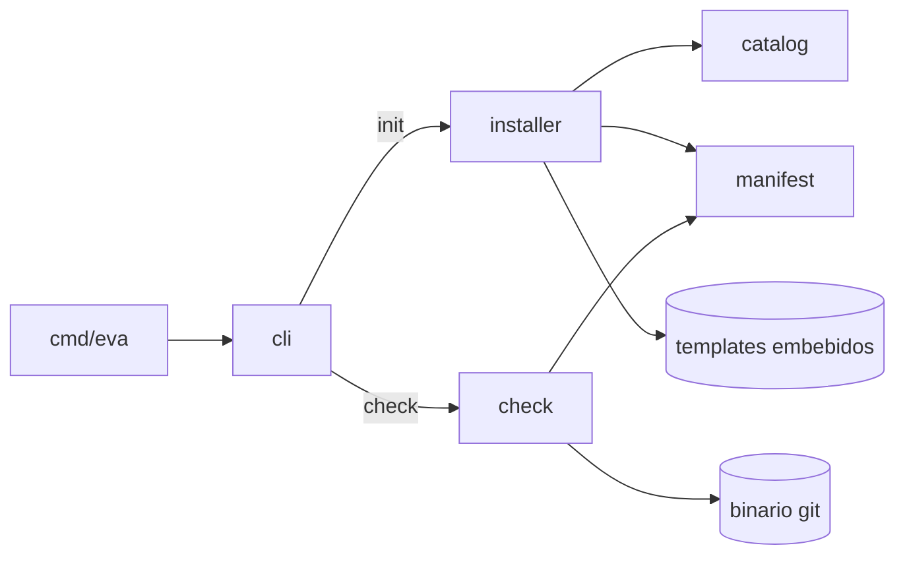

# Contribuir y arquitectura

[English](../contributing.md) · **Español** · [Índice](README.md)

## Preparación

Requisitos: Go 1.24+ y git.

```sh
git clone https://github.com/codebymaribel/eva-sdd && cd eva-sdd
make test     # go test ./...
make lint     # go vet + chequeo de gofmt
make build    # bin/eva (versión desde git describe)
make install  # go install ./cmd/eva
make golden   # regenera los goldens del instalador después de editar templates/
```

CI (`.github/workflows/ci.yml`) corre `make lint` y `make test` en los push a `main` y en los pull requests.

Para probar un cambio a mano, corre `make install` y usa `eva init` / `eva check` en un proyecto descartable: ver el [tutorial](tutorial.md).

## Principios

- **Solo la biblioteca estándar.** `go install` tiene que funcionar sin módulos de terceros. Las preguntas interactivas pasan por la interfaz `prompt.Prompter`, así más adelante se puede enchufar una UI más rica.
- **Tests primero.** Cada cambio viene con tests; los cambios de templates vienen con los goldens actualizados.
- **Una feature a la vez.** Cambios acotados; no toques archivos que no tienen que ver.
- Los templates están en **inglés**. La documentación está en inglés (`docs/`) y en español (`docs/es/`): actualiza ambas.

## Estructura del repositorio

```
cmd/eva/main.go          punto de entrada: versión, detección de terminal, código de salida
internal/
  cli/                   subcomandos: init (asistente + flags), check (reporte), ayuda
  catalog/               stacks y agentes soportados, ids y alias
  manifest/              lectura y escritura de .eva/config.json
  installer/             plan/aplicación de templates, bloques gestionados, goldens
  check/                 validación de documentos y gate por rama
  prompt/                preguntas por línea detrás de la interfaz Prompter
  textdiff/              diffs unificados por línea para `eva init --diff`
templates/
  embed.go               embebe core/, stacks/ y agents/ en el binario
  core/                  se instala en todos los proyectos
  stacks/<id>/           se instala si se elige el stack
  agents/<id>/           se instala si se elige el agente
docs/                    esta documentación (es/ = español)
```

## Arquitectura



### `eva init`

1. `cli.resolveConfig` combina los flags, el manifest existente y las respuestas del asistente. Se mantienen los stacks y agentes instalados (unión, en el orden del catálogo). Carpeta de la app: `--path` > manifest > pregunta > valor por defecto.
2. `installer.Plan` lee el árbol embebido, renderiza los `*.tmpl` y compara cada destino con lo que existe. Nunca escribe.
3. Cada archivo recibe un `Op`: `create`, `update`, `unchanged`, `skip` o `delete`. Los bloques gestionados (`*.block`) se combinan con `MergeBlockFor`, que elige marcadores de comentario HTML para Markdown y marcadores `#` para `.gitattributes`; el manifest y el lock siempre se reescriben. El resto de los archivos se compara con el hash guardado en `.eva/eva-lock.json` (`lock.go`; `HashContent` normaliza CRLF): los intactos se actualizan, los editados se saltean salvo con `--force`, y los que eva ya no trae se informan o, con `--prune` y si están intactos, se borran.
4. `installer.Apply` escribe las acciones `create`/`update` y borra las `delete`. Con `--diff`, el CLI imprime `textdiff.Unified` (un diff por líneas con LCS, porque la biblioteca estándar no trae uno) para las acciones con `Diffable()` verdadero.

### `eva check`

`check.Run` carga el manifest, recorre las carpetas `specs/NNN-slug/` y parsea cada documento con `ParseFrontMatter` (subconjunto plano `clave: valor`). Después:

| Archivo | Responsabilidad |
|---------|-----------------|
| `check.go` | `Run`, recorrido de features, reglas de estado y aprobación, orden de fases, constitución, gate por rama |
| `frontmatter.go` | parser de front-matter, contadores de `[NEEDS CLARIFICATION]`, `TODO` y checkboxes |
| `meta.go` | reglas de `type` y fechas para todos los documentos (EVA060–065) |
| `requirements.go` | parseo de `FR-n`, EARS, criterios de finalización, el helper genérico `section` (EVA026–029) |
| `clarify.go` | hallazgos de clarify y el gate de aprobación (EVA070–074) |
| `traceability.go` | trazabilidad del plan, tasks, veredicto de la verificación (EVA080–093) |
| `git.go` | la interfaz `Git` y `ExecGit` |

Los hallazgos son `{Severity, Code, Path, Message}`; el reporte se ordena por ruta y código. `isCodePath` decide qué es código.

## Templates

- Los `*.tmpl` se renderizan con `text/template` usando los delimitadores `[[ ]]`, así las `{{ }}` de Markdown o JSX no se tocan. Datos: `.Project`, `.EvaVersion`, `.Stacks` (`ID`, `Name`, `Path`), `.Agents` (`ID`, `Name`); función `stackPath "<id>"`.
- Los `*.block` se combinan entre `<!-- eva:start … -->` y `<!-- eva:end -->`, así se conserva el contenido del usuario fuera del bloque (`AGENTS.md`, `CLAUDE.md`).
- El sufijo se quita del nombre de destino.
- Los atajos de cada agente (`templates/agents/<id>/…/eva-*.md`) solo apuntan a `.eva/commands/<fase>.md`; las instrucciones reales van en el comando del core.

Después de cualquier cambio de templates, corre `make golden` y revisa el diff en `internal/installer/testdata/golden/`: los goldens son exactamente lo que recibe un proyecto.

## Tests

| Paquete | Patrón |
|---------|--------|
| `check` | `newProject(t)` arma un proyecto temporal; helpers `doc`, `clarify`, `verification`, `front`, `write`, `remove`; fixtures `specBody`, `planBody`, `tasks(...)`, `verificationBody`. `expectCodes(t, report, "EVA0xx"…)` comprueba el conjunto exacto de códigos. Git se simula con `fakeGit`; `TestExecGitIntegration` usa el binario real. |
| `installer` | árboles golden por configuración (`rn-claude`, `next-opencode`, `monorepo-all`), idempotencia, merge y `--force`; `upgrade_test.go` simula versiones nuevas de eva con árboles de templates chicos en `fstest.MapFS` (archivos intactos/editados, obsoletos, `--prune`, CRLF, proyectos sin lock) |
| `cli` | `runApp(t, interactive, stdin, args...)` devuelve el código de salida, stdout y stderr |

Atajo de fixtures: `p.doc(id, "spec.md", "approved"|"done", …)` también escribe el `clarify.md` (y, con `done`, el `verification.md`) que eva exige, así cada test se concentra en una regla.

## Cómo…

### Agregar una regla de chequeo

1. Elige el siguiente código libre en el rango que corresponde y escribe primero el test que falla (`expectCodes`).
2. Impleméntala en el archivo dueño de ese documento; reutiliza `section`, `ParseRequirements`, `ParseTasks`, `contentSeverity`.
3. Actualiza la tabla de códigos de `README.md`, [`check-reference.md`](check-reference.md) y su copia en inglés, y `templates/core/specs/README.md` si los usuarios tienen que conocer la regla.
4. Si los agentes la tienen que seguir, actualiza `.eva/commands/*.md` y corre `make golden`.

### Agregar un stack

1. Agrégalo a `catalog.Stacks` (id, nombre, alias, carpeta por defecto).
2. Crea `templates/stacks/<id>/.eva/stacks/<id>.md.tmpl` con las mismas secciones que los stacks existentes (base, comandos, estructura, presupuestos, checklist con ids de reglas, testing, accesibilidad).
3. Agrega un caso golden en `internal/installer/installer_test.go` y corre `make golden`.
4. Documéntalo en `README.md` y `docs/getting-started.md` (ambos idiomas).

### Agregar un agente

1. Agrégalo a `catalog.Agents`.
2. Crea `templates/agents/<id>/` con un atajo por fase en el formato de comandos del agente, cada uno apuntando a `.eva/commands/<fase>.md`, más un `*.block` si el agente lee su propio archivo de instrucciones.
3. Agrega un caso golden, corre `make golden` y actualiza la documentación.

### Cambiar el flujo

Un cambio de flujo toca varios lugares a la vez: `AGENTS.md.block.tmpl` (reglas), `.eva/commands/*.md` (pasos), `.eva/templates/*.md` (formatos), `specs/README.md` (resumen), el checker, los goldens y los dos idiomas de esta documentación. Registra la decisión en el [roadmap](roadmap.md).
