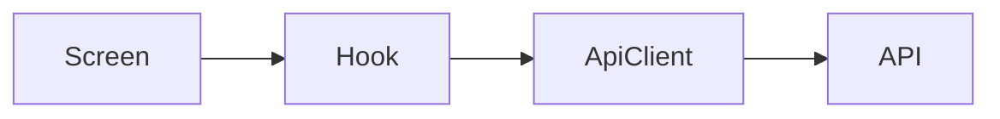

# Plan: Feature title

> **How** the approved spec will be built. Written only after `spec.md` is approved. Every section is required; write "N/A — reason" when one does not apply.

## 1. Approach

A short paragraph: the overall solution and why it fits the spec.

## 2. Requirements traceability

Every `FR-n` of the spec appears here at least once, and every part of the plan below exists because of a requirement (or says why it supports one). `eva check` fails when an FR is missing here or when the plan cites an FR the spec does not define.

| FR | Plan sections | Components / files | Test level |
|----|---------------|--------------------|------------|
| FR-1 | §4, §7 | `LoginForm`, `useLogin` | unit + e2e |

## 3. Constitution check

| Principle | Complies? | Notes |
|-----------|-----------|-------|
| Spec before code | Yes | spec approved by … |
| Tests are part of done | | |
| Performance is a feature | | |
| Scalable by structure | | |
| Type safety | | |
| Simplicity / no new deps without reason | | |
| Accessible by default | | |

Any "No" must be justified here or the plan cannot be approved.

## 4. Architecture

Components/modules involved and how data flows between them.



## 5. Data model and types

```ts
// Types and schemas introduced or changed by this feature.
export interface Example {
  id: string;
}
```

## 6. API contracts

| Method | Endpoint / action | Request | Response | Errors |
|--------|-------------------|---------|----------|--------|
| | | | | |

## 7. State management

Server state vs client state, where each lives, cache keys and invalidation.

## 8. Navigation / routing

Routes or screens added or changed, params, deep links.

## 9. File map

The only files this feature may create or modify. Anything else requires updating this plan.

| Action | Path | Purpose |
|--------|------|---------|
| Create | | |
| Modify | | |

## 10. Performance considerations

Reference the stack checklist by rule id and explain how each applicable rule is met.

| Rule id | Applies because | How it is met |
|---------|-----------------|---------------|
| | | |

Expected impact on the performance budgets in the stack file:

## 11. Testing strategy

Every requirement (`FR-n`) maps to at least one test.

| FR | Test level (unit / integration / e2e) | Test file | Notes |
|----|----------------------------------------|-----------|-------|
| FR-1 | | | |

## 12. Dependencies

New or upgraded packages, with the reason and bundle/binary-size impact. Cross-cutting decisions link an ADR in `docs/adr/`.

## 13. Risks and mitigations

| Risk | Likelihood | Impact | Mitigation |
|------|------------|--------|------------|
| | | | |

## 14. Rollout

Feature flag, migrations, backwards compatibility, monitoring.

## 15. Alternatives considered

Options that were rejected and why.
